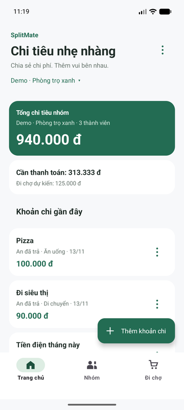
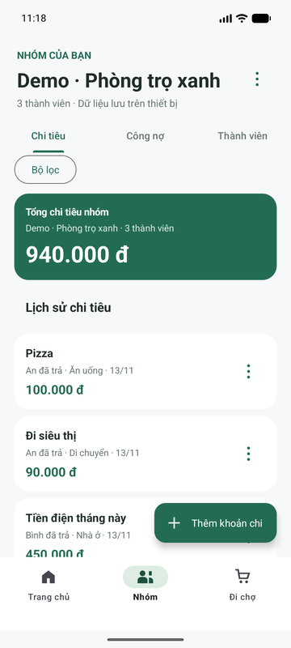
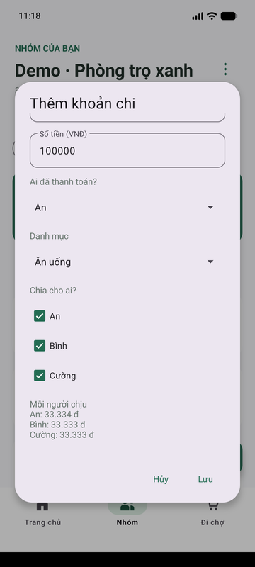
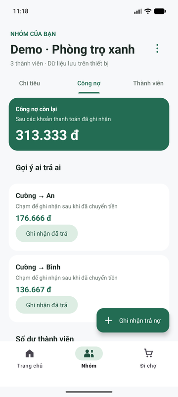
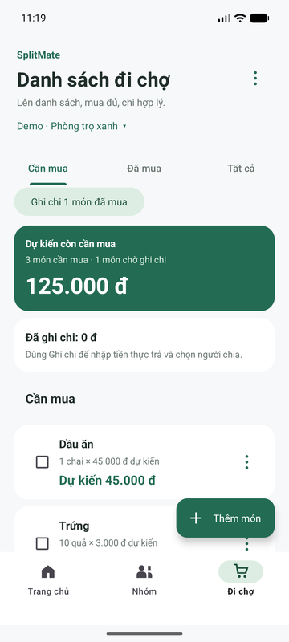
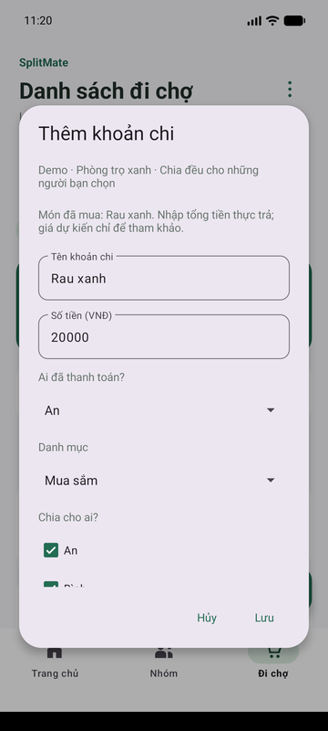
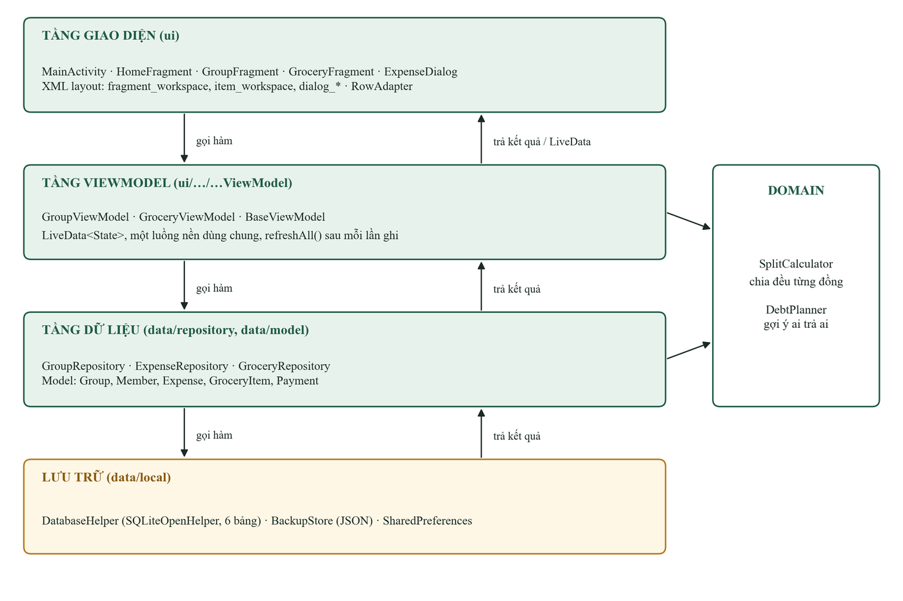

# SplitMate – Quản lý chi tiêu nhóm trên Android

Ứng dụng Android giúp một nhóm người (phòng trọ, nhóm bạn đi du lịch, đồng nghiệp…) ghi lại chi tiêu chung,
chia tiền chính xác đến từng đồng, biết ngay **ai cần trả cho ai**, và quản lý danh sách đi chợ chung.
Ứng dụng chạy hoàn toàn **offline**, dữ liệu lưu trên máy bằng SQLite.

> Dự án tiểu luận học phần **Lập trình di động** – Java, XML, SQLite, kiến trúc MVVM.

-3DDC84?logo=android&logoColor=white)


## Ảnh màn hình

| Trang chủ | Lịch sử chi tiêu | Thêm khoản chi |
|:---:|:---:|:---:|
|  |  |  |
| **Công nợ – ai trả ai** | **Danh sách đi chợ** | **Ghi chi từ món đã mua** |
|  |  |  |

## Tính năng

- **Nhóm và thành viên** – tạo nhiều nhóm, thêm / đổi tên / xóa thành viên. Ứng dụng nhớ nhóm bạn chọn lần trước.
- **Khoản chi** – nhập tên, số tiền, người trả, danh mục và những người chia; xem trước phần tiền của từng người
  trước khi lưu. Tiền được chia đều **chính xác từng đồng** (100.000 đ / 3 người → 33.334 + 33.333 + 33.333).
- **Bộ lọc lịch sử** – lọc theo tên khoản chi, danh mục, người trả và tháng.
- **Công nợ** – số dư của từng người, gợi ý **ai trả ai** để cả nhóm cân bằng, biểu đồ chi tiêu theo danh mục.
- **Ghi nhận thanh toán** – lưu lần chuyển tiền giữa hai người, cho phép trả một phần.
- **Đi chợ** – danh sách món (số lượng, đơn vị, giá dự kiến) với 3 tab *Cần mua / Đã mua / Tất cả*.
  Chọn các món cùng một hóa đơn, nhập số tiền thực trả để tạo một khoản chi liên kết; mỗi món chỉ ghi chi được một lần.
- **Sao lưu / khôi phục** – xuất toàn bộ dữ liệu ra tệp JSON; khôi phục thành nhóm mới có hậu tố `(khôi phục)`.
- **Dữ liệu demo** – tạo nhóm mẫu `Demo · Phòng trọ xanh` để thử ngay.

## Công nghệ

| Thành phần | Sử dụng |
|---|---|
| Ngôn ngữ | Java 11, giao diện XML |
| Giao diện | AppCompat, Material Components 3, RecyclerView + ListAdapter/DiffUtil, ViewBinding |
| Kiến trúc | MVVM: ViewModel, LiveData, Repository |
| Lưu trữ | SQLite (`SQLiteOpenHelper`), khóa ngoại, transaction; SharedPreferences |
| Build | Gradle 9.5, Android Gradle Plugin 9.1.1, compileSdk/targetSdk 37, minSdk 25 |
| Kiểm thử | JUnit 4, AndroidX Test, Espresso |

## Kiến trúc



Luồng dữ liệu: **Fragment** (giao diện) → **ViewModel** (luồng nền, LiveData) → **Repository** → **DatabaseHelper** (SQLite).

```
app/src/main/java/com/example/quanlychitieu/
├── MainActivity                 Điều hướng Trang chủ / Nhóm / Đi chợ
├── data/
│   ├── local/                   DatabaseHelper (6 bảng, transaction, nâng cấp phiên bản), BackupStore (JSON)
│   ├── model/                   Group, Member, Expense, GroceryItem, Payment, CategoryTotal
│   └── repository/              GroupRepository, ExpenseRepository, GroceryRepository
├── domain/                      SplitCalculator (chia đều từng đồng), DebtPlanner (gợi ý ai trả ai)
└── ui/
    ├── common/                  BaseScreenFragment, BaseViewModel, RowAdapter, RowList, Format, Forms
    ├── home/                    HomeFragment
    ├── group/                   GroupFragment, GroupViewModel, ExpenseDialog
    └── grocery/                 GroceryFragment, GroceryViewModel
```

- Chỉ các lớp **Repository** chứa câu lệnh SQL; ViewModel và Fragment chỉ làm việc với các lớp trong `data/model`.
- `BaseViewModel` chạy mọi thao tác database trên **một luồng nền dùng chung**, nên các lần ghi luôn theo đúng thứ tự
  và giao diện không bị treo. Sau mỗi lần ghi, mọi ViewModel tự tải lại dữ liệu.
- `GroupViewModel` gắn với Activity nên cả 3 màn hình luôn xem cùng một nhóm, và dữ liệu không mất khi xoay màn hình.
- Giao diện viết bằng XML trong `res/layout`: `fragment_workspace.xml` (khung màn hình dùng chung),
  `item_workspace.xml` (một dòng danh sách), `dialog_*.xml` (các hộp thoại nhập liệu).

### Cơ sở dữ liệu

6 bảng: `groups`, `members`, `expenses`, `expense_shares`, `grocery_items`, `settlements`.

- Số tiền lưu bằng **số nguyên** (đồng) để không có sai số làm tròn.
- Phần tiền mỗi người được lưu riêng trong `expense_shares`, tổng luôn bằng số tiền khoản chi.
- Xóa nhóm sẽ xóa dây chuyền toàn bộ dữ liệu của nhóm (`ON DELETE CASCADE`); thành viên đã có giao dịch thì không xóa được.
- Số dư không lưu sẵn mà tính bằng SQL mỗi lần đọc: `Số dư = Đã trả − Phải chịu + Đã chuyển đi − Đã nhận`.

### Thuật toán

- **Chia đều** (`SplitCalculator`): mỗi người nhận `S / n`, phần dư `S mod n` được cộng thêm 1 đồng cho những người đầu danh sách.
- **Gợi ý trả nợ** (`DebtPlanner`): thuật toán tham lam ghép người nợ nhiều nhất với người được nhận nhiều nhất
  cho đến khi mọi số dư về 0. Kết quả luôn cân bằng nhưng không cam kết số giao dịch ít nhất tuyệt đối.

## Cài đặt và chạy

**Yêu cầu:** Android Studio hoặc IntelliJ IDEA (có plugin Android hỗ trợ AGP 9.1), JDK 17 trở lên,
máy ảo hoặc điện thoại Android 7.1 (API 25) trở lên.

```bash
git clone https://github.com/hominhduc-dev/android-splitmate.git
```

1. Mở thư mục dự án bằng Android Studio / IntelliJ IDEA và chờ Gradle Sync xong.
2. Chọn cấu hình **app**, biến thể **debug**, rồi bấm **Run**.
3. Trong ứng dụng, bấm **⋮ → Tạo dữ liệu demo** để có sẵn dữ liệu mẫu.

Build APK bằng dòng lệnh (Windows):

```bash
./gradlew.bat assembleDebug
```

APK nằm ở `app/build/outputs/apk/debug/app-debug.apk`.

## Kiểm thử

```bash
./gradlew.bat testQaUnitTest lintDebug
```

```bash
./gradlew.bat connectedQaAndroidTest
```

- **Kiểm thử đơn vị:** chia tiền và phần dư, gợi ý thanh toán, các trường hợp dữ liệu không hợp lệ.
- **Kiểm thử trên thiết bị:** nâng cấp cơ sở dữ liệu không mất dữ liệu, chống ghi chi một món hai lần,
  sao lưu / khôi phục giữ đúng liên kết, luồng nhóm → khoản chi → trả nợ → đi chợ vẫn đúng sau khi Activity bị tạo lại.
- Kiểm thử chạy trên bản build **qa** (applicationId `com.example.quanlychitieu.qa`), nên không đụng tới dữ liệu của bản ứng dụng chính.

## Hướng dẫn nhanh: đi chợ

1. Chọn nhóm ở đầu màn hình **Đi chợ**, bấm **Thêm món** và nhập tên, số lượng, đơn vị, đơn giá dự kiến (giá chưa biết có thể để 0).
2. Mua xong thì tích vào ô vuông của món; món chuyển sang tab **Đã mua**. Tích ô vuông **không** tự tạo khoản chi.
3. Bấm **Ghi chi … món đã mua**, chọn các món trên cùng một hóa đơn, nhập **tổng tiền thực trả**, người trả và người chia.
4. Món đã ghi chi được liên kết với hóa đơn; chạm vào món để mở hóa đơn. Xóa hóa đơn sẽ đưa các món về trạng thái *đã mua – chưa ghi chi*.

## Giới hạn

- Dữ liệu chỉ nằm trên một thiết bị, chưa đồng bộ qua máy chủ.
- Chỉ hỗ trợ chia đều; chưa chia theo tỷ lệ hay số phần.
- Tệp sao lưu JSON **không mã hóa**; giới hạn nhập tệp 10 MB và tổng 100.000 dòng.
- Lịch sử chi tiêu chưa phân trang; hộp thoại nhập liệu chưa giữ bản nháp khi xoay màn hình.
